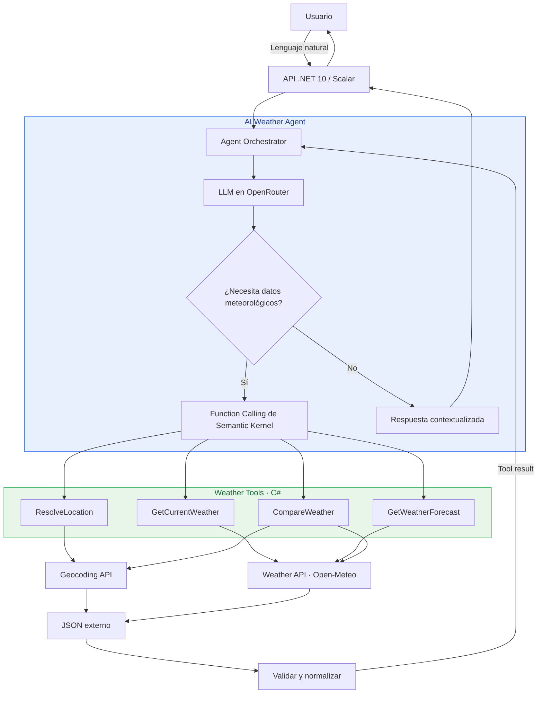
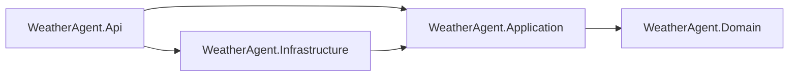

# Asistente meteorológico · AI Weather Agent

Ejemplo educativo en **C#, .NET 10, Semantic Kernel, Scalar y OpenRouter**, siguiendo la estructura de **Smart Calculator Agent**. El modelo selecciona herramientas, consulta Open-Meteo y transforma resultados externos en respuestas como «¿sería buen día para salir a correr?». El reto de comparar varias ciudades está implementado.

## Arranque

Necesitas el SDK de .NET 10, acceso a Internet y una clave de OpenRouter. Ejecuta estos comandos desde esta carpeta:

```powershell
dotnet restore WeatherAgent.slnx
$env:OPENROUTER_API_KEY = 'tu-clave'
dotnet run --project src/WeatherAgent.Api --launch-profile http
```

Abre [Scalar](http://localhost:5280/scalar/v1). La API escucha en `http://localhost:5280`, en un puerto distinto al de la calculadora. También puedes abrir `WeatherAgent.slnx` en Visual Studio y utilizar `src/WeatherAgent.Api/WeatherAgent.Api.http`.

Como alternativa a la variable de entorno, guarda la clave fuera del repositorio con secretos de desarrollo:

```powershell
dotnet user-secrets set 'OpenRouter:ApiKey' 'tu-clave' --project src/WeatherAgent.Api
```

`OPENROUTER_API_KEY` tiene prioridad sobre `OpenRouter:ApiKey`. No guardes claves en `appsettings.json`. Los secretos de desarrollo se cargan en Development. Reinicia el proceso después de cambiar la clave o el modelo.

Se conserva el modelo configurado en la calculadora de referencia: `dots-studio/dots-3-note-preview:free`. Su disponibilidad, cuotas y compatibilidad pueden variar. Selecciona en `Agent:Model` o `Agent__Model` un identificador disponible en tu cuenta que admita **tool calling**. `Agent__ReasoningEnabled=false` desactiva la extensión de reasoning si tu modelo no la admite. El proyecto no impone que uses un modelo gratuito.

Open-Meteo se consulta sin clave mediante sus endpoints públicos para este ejemplo; revisa sus [condiciones y planes](https://open-meteo.com/en/pricing) para otros usos.

## Ejemplos

```powershell
$body = @{ message = '¿Sería buen día para salir a correr mañana en Valencia, España? Recomienda una hora.' } | ConvertTo-Json
Invoke-RestMethod -Method Post -Uri 'http://localhost:5280/api/weather' -ContentType 'application/json; charset=utf-8' -Body ([Text.Encoding]::UTF8.GetBytes($body))
```

Otras preguntas:

- «¿Qué tiempo hace ahora en Madrid, España?»
- «Compara Madrid, España; Barcelona, España; y Sevilla, España para correr mañana.»
- «¿Qué significa sensación térmica?»
- «¿Qué tiempo hará en Springfield?» — permite observar la resolución de ambigüedades.
- «Consulta la previsión para una fecha fuera de los próximos 16 días.» — permite observar un error recuperable.

`POST /api/weather` acepta `{ "message": "..." }` y devuelve:

```json
{
  "answer": "Respuesta contextualizada del modelo…",
  "model": "identificador configurado",
  "steps": [
    {
      "order": 1,
      "tool": "Weather.ResolveLocation",
      "arguments": { "city": "Valencia, España" },
      "result": {
        "success": true,
        "data": [
          {
            "name": "Valencia",
            "region": "Comunidad Valenciana",
            "country": "España",
            "countryCode": "ES",
            "latitude": 39.4699,
            "longitude": -0.3763,
            "timezone": "Europe/Madrid"
          }
        ],
        "errorCode": null,
        "error": null
      }
    }
  ]
}
```

El JSON anterior es ilustrativo, abreviado a una herramienta. `steps` contiene las invocaciones y observaciones estructuradas, no razonamiento interno. Una respuesta conceptual puede tener `steps: []`. Cada petición tiene su propio historial; las consultas posteriores deben incluir de nuevo la ciudad y la fecha.

## Arquitectura



1. `WeatherAgentService` solicita una sesión independiente a `IAgentSessionFactory`; el adaptador crea el Kernel y el historial por solicitud. Proporciona al modelo el instante UTC actual y las descripciones de las herramientas.
2. Semantic Kernel expone las funciones de `WeatherPlugin`. El modelo decide si responde, solicita aclaración o invoca una o varias herramientas.
3. El orquestador ejecuta las llamadas explícitamente, registra argumentos y resultados y devuelve cada observación al modelo. Los pasos dependientes esperan el resultado anterior.
4. El modelo interpreta las observaciones para responder y comparar. La selección de horas y recomendaciones se expresa en el prompt; no existe un clasificador determinista que garantice esas decisiones.

| Herramienta | Entrada | Resultado |
| --- | --- | --- |
| `ResolveLocation` | `city` | Candidatos con nombre, región, país, coordenadas y zona horaria. Prioriza nombres exactos sobre prefijos, sin eliminar homónimos. |
| `GetCurrentWeather` | `latitude`, `longitude` | Hora local, temperatura y sensación en °C, humedad %, precipitación mm, viento km/h y código WMO. |
| `GetWeatherForecast` | Coordenadas y `date` | Resumen diario y horas locales: temperatura, sensación, lluvia probable, viento, código WMO y luz diurna. Incluye UV máximo diario. |
| `CompareWeather` | `locations` (2–5 ciudades), `date` | Previsiones por ciudad, errores individuales y `complete`. Consulta las ciudades en paralelo. El modelo interpreta la comparación. |

Las fechas admiten `today`, `tomorrow` o `YYYY-MM-DD`. Se usa el día local del destino, con sus reglas de zona horaria, para validar el intervalo de hoy a hoy + 15 días. El cliente pide 16 días de previsión y selecciona la fecha solicitada. No consulta datos históricos. Las horas se expresan en la zona devuelta por Open-Meteo, sin sufijo UTC.

Para evitar interpretar un nombre ambiguo, `CompareWeather` solo consulta la previsión si queda un único candidato. Los demás casos devuelven candidatos para concretar el lugar. `complete=false` indica resultados parciales; si fallan todas las ciudades, `success=false` conserva los errores de cada una.

## Errores y límites

- HTTP 400: mensaje ausente, vacío, mayor de 4000 caracteres o JSON inválido.
- HTTP 422: límite de rondas o invocaciones del agente.
- HTTP 503: falta la clave de OpenRouter.
- HTTP 504: vence el plazo global del agente.
- HTTP 502: fallo de OpenRouter, con código estructurado para autenticación, créditos, modelo no disponible, cuota o conexión. Los detalles privados del proveedor no se devuelven.

Los fallos meteorológicos son **resultados de herramienta** (`success=false`) para que el modelo pueda explicarlos o corregir la consulta: ciudad desconocida, ubicación ambigua, coordenadas/fecha inválidas, fecha fuera de rango, HTTP 429, fallo de conexión, timeout o JSON incompleto. La petición puede devolver HTTP 200 con una explicación de esos errores; examina también `steps[].result.success`.

Los valores nulos, códigos WMO desconocidos y arrays desalineados no se sustituyen por ceros. Temperaturas, probabilidades y coordenadas tienen validaciones de rango. Los hosts HTTP son fijos; los nombres se codifican en la URL. La cancelación del cliente se propaga a las llamadas externas.

Configuración por defecto: 12 rondas, 24 invocaciones, 90 segundos por solicitud y 15 segundos por petición a Open-Meteo. Cada comparación admite hasta cinco ciudades, por lo que una invocación puede producir varias peticiones HTTP. No se hacen reintentos automáticos ni se cachean previsiones. Las variables `Agent__MaxRounds`, `Agent__MaxToolCalls` y `Agent__TimeoutSeconds` permiten ajustar los límites.

La evaluación para correr usa las variables disponibles; no proporciona alertas oficiales, calidad del aire ni UV por hora. Las condiciones actuales son estimaciones meteorológicas, y una previsión no garantiza las condiciones futuras. Scalar y OpenAPI solo se exponen en Development. La API es un ejemplo local sin autenticación de usuarios; añade los controles de acceso y consumo correspondientes antes de exponerla públicamente.

## Pruebas

```powershell
dotnet test WeatherAgent.slnx
```

Las pruebas habituales no llaman a OpenRouter ni a Open-Meteo: verifican selección e invocación de herramientas mediante un modelo simulado, encadenamiento, aislamiento de historial, trazas, límites, normalización JSON, errores, fechas en distintas zonas horarias, comparación parcial y respuestas HTTP. No garantizan el comportamiento de un modelo real.

La prueba de integración con Open-Meteo es optativa y no consume créditos de IA:

```powershell
dotnet test WeatherAgent.slnx --environment WEATHER_LIVE_TESTS=1
```

Comprueba geocodificación, condiciones actuales, previsión por horas y comparación Madrid–Barcelona. Requiere Internet y puede fallar por disponibilidad o cuotas del servicio. Para verificar OpenRouter de extremo a extremo, configura tu clave y envía las consultas del archivo `.http`; esas consultas están sujetas a las tarifas del modelo elegido.

## Clean Architecture



- `src/WeatherAgent.Domain`: modelos meteorológicos, coordenadas, fechas locales e interpretación de códigos WMO.
- `src/WeatherAgent.Application`: casos de uso, instrucciones, presupuestos, trazas y puertos `IAgentSessionFactory`, `IAgentSession`, `IProviderAvailability` e `IProviderFailureClassifier`; `IWeatherClient` y `WeatherTools` coordinan las consultas y comparaciones. No depende de Semantic Kernel, HTTP ni de la API.
- `src/WeatherAgent.Infrastructure`: sesiones Semantic Kernel, plugins con atributos, cliente OpenRouter, reasoning y clasificación de errores del proveedor; cliente HTTP Open-Meteo y normalización de sus respuestas.
- `src/WeatherAgent.Api`: composición, configuración del host, endpoints, validación HTTP, Problem Details y Scalar. `Program.cs` registra los adaptadores mediante `AddInfrastructure()`.
- `tests/WeatherAgent.Application.Tests`: pruebas de casos de uso con sesiones simuladas, cancelación, aislamiento, límites, liberación de recursos y reglas de dependencias; referencia únicamente Application.
- `tests/WeatherAgent.Tests`: pruebas de dominio, adaptadores y contratos HTTP existentes.

Cada solicitud crea una sesión independiente a través del puerto. Application decide cuándo llamar al modelo o ejecutar una herramienta; Infrastructure traduce esas decisiones a Semantic Kernel y conserva su historial nativo. Los contratos JSON, rutas, puertos y opciones de configuración se mantienen.

Para practicar: inspecciona `steps` al cambiar una pregunta conceptual por una pregunta sobre el tiempo; compara varias ciudades; consulta una ciudad inexistente; cambia la fecha; observa qué datos usa el modelo para recomendar una hora. Como ampliaciones puedes añadir caché, streaming, evaluación de recomendaciones o una consola que reutilice los mismos servicios.

Datos meteorológicos: [Open-Meteo](https://open-meteo.com/) · Ubicaciones: [GeoNames](https://www.geonames.org/). Referencias: [Forecast API](https://open-meteo.com/en/docs), [Geocoding API](https://open-meteo.com/en/docs/geocoding-api), [OpenRouter tool calling](https://openrouter.ai/docs/guides/features/tool-calling), [Semantic Kernel](https://github.com/microsoft/semantic-kernel).
