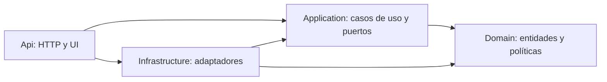
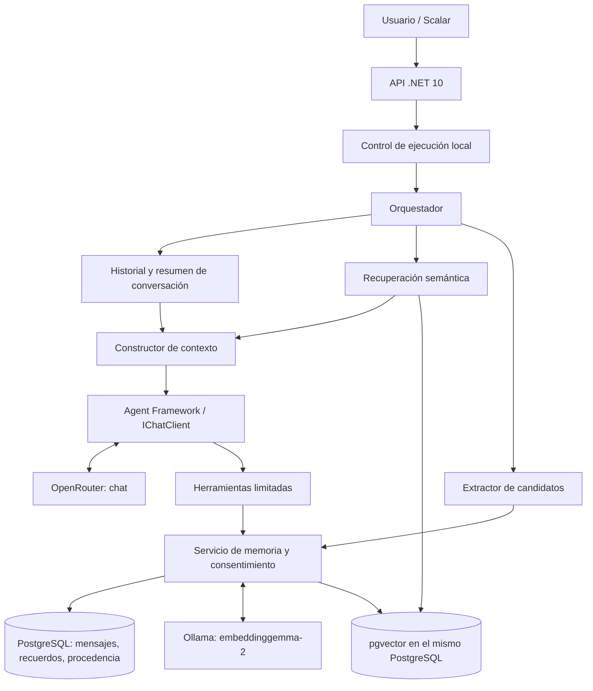

# Asistente personal con memoria

Ejemplo educativo en **C# / .NET 10, Microsoft Agent Framework, Microsoft.Extensions.AI, OpenRouter, Ollama, PostgreSQL, pgvector, EF Core y Scalar**. Mantiene conversaciones entre reinicios, propone recuerdos para aprobación y recupera información por significado en conversaciones nuevas.

## Arranque

Requisitos: SDK de .NET 10, Docker con motor Linux operativo y una clave de OpenRouter para el chat. Compose ejecuta PostgreSQL y Ollama en contenedores; no hace falta instalar Ollama en Windows. Los embeddings se generan localmente con `embeddinggemma-2`, mediante `POST /api/embed` de Ollama. Ejecuta los comandos desde esta carpeta:

```powershell
dotnet restore MemoryAssistant.slnx -m:1
dotnet tool restore
docker compose up -d --wait
docker compose exec ollama ollama pull embeddinggemma-2

$env:OPENROUTER_API_KEY = 'tu-clave'
$env:Agent__Model = 'identificador-de-un-modelo-con-tools-y-json'
$env:Embeddings__BaseUrl = 'http://localhost:11435'
$env:Embeddings__Model = 'embeddinggemma-2'
$env:Embeddings__Dimensions = '768'

dotnet run --project src/MemoryAssistant.Api --no-launch-profile -- --migrate
dotnet run --project src/MemoryAssistant.Api --launch-profile http
```

El modelo de chat es obligatorio y **no tiene un valor predeterminado**: elige un modelo de OpenRouter que admita herramientas y JSON para extracción. No se presupone que existan modelos gratuitos con todas esas capacidades. Las llamadas de chat, extracción y resumen pueden consumir créditos de OpenRouter. Los embeddings locales no requieren clave ni créditos de OpenRouter; utilizan recursos del equipo. La clave del chat se lee primero de `OPENROUTER_API_KEY` y después de `OpenRouter:ApiKey`.

Ollama usa la imagen oficial `ollama/ollama:0.40.7`, con ejecución en CPU y volumen persistente `ollama-data`. La API .NET se ejecuta en Windows y accede al contenedor en `http://localhost:11435`; dentro del contenedor Ollama escucha en `11434`. El puerto publicado está vinculado únicamente a `127.0.0.1` y permite convivir con Ollama instalado en Windows en `11434`. Las variables de entorno anteriores sustituyen configuraciones antiguas de embeddings; actualiza también `Embeddings:BaseUrl` en los secretos de desarrollo si lo tenías definido. El modelo devuelve por defecto vectores de 768 dimensiones.

La primera descarga del modelo requiere Internet y espacio en disco. `docker compose up -d --wait` espera a que ambos servicios estén disponibles; después, `docker compose exec ollama ollama pull embeddinggemma-2` descarga el modelo al volumen. El healthcheck comprueba el servidor, y la prueba real de embeddings comprueba también el modelo.

Comandos de mantenimiento:

```powershell
docker compose ps
docker compose exec ollama ollama list
docker compose logs --tail 50 ollama
docker compose down
```

`docker compose down` conserva los modelos y la base de datos. `docker compose down -v` elimina ambos volúmenes y sus datos. Si más adelante ejecutas la API dentro de la misma red Compose, configura `Embeddings__BaseUrl=http://ollama:11434`.

Si ya guardaste recuerdos con otro modelo, arranca la API y reindexa explícitamente:

```powershell
Invoke-RestMethod -Method Post -Uri 'http://localhost:5281/api/memories/reindex'
```

La reindexación conserva los recuerdos aprobados y sustituye sus vectores. No hace falta borrar la base de datos ni cambiar su esquema. Revisa los avisos de la respuesta si Ollama falla o falta el modelo.

Alternativa para la clave:

```powershell
dotnet user-secrets set 'OpenRouter:ApiKey' 'tu-clave' --project src/MemoryAssistant.Api
dotnet user-secrets set 'Agent:Model' 'identificador-del-modelo' --project src/MemoryAssistant.Api
```

Abre el [chat de Memoria](http://localhost:5281/) para conversar. También puedes usar [Scalar](http://localhost:5281/scalar/v1). OpenAPI y Scalar se exponen en Development. La API puede arrancar sin clave y sin PostgreSQL para consultar la interfaz y la documentación; las operaciones que los necesitan informan del fallo. `GET /health` comprueba el proceso y `GET /health/ready` comprueba conexión, extensión vector y esquema de aplicación.

## Interfaz de chat

El frontal está incluido en `wwwroot` y se sirve desde la misma API, sin Node.js, paquetes de frontend ni otro servidor para ejecutarlo.

- Crea conversaciones con **Nueva conversación** o **Alt + N** y retómalas desde el historial lateral. El buscador filtra sus títulos; se muestran las 100 conversaciones más recientes.
- Escribe y pulsa **Enter** para enviar; **Mayús + Enter** añade una línea. Las sugerencias rellenan el borrador para que puedas revisarlo antes de enviarlo.
- **Detener** cancela la solicitud y actualiza el historial: el mensaje puede haberse guardado ya. No hay reenvíos automáticos; **Recuperar borrador** permite revisar el texto antes de enviarlo otra vez.
- En **Recuerdos**, revisa las pestañas **Guardados** y **Por revisar**. Puedes aprobar, descartar, editar u olvidar. Los datos sensibles necesitan una casilla de consentimiento específico; los cambios de versión requieren revisar de nuevo el recuerdo.
- El borrado de recuerdos y conversaciones muestra una confirmación con sus consecuencias. Después se recargan historial y recuerdos para retirar de la vista la información excluida.

La interfaz se adapta a móvil, permite copiar respuestas y muestra bloques de código y formato básico sin interpretar HTML del usuario o del modelo. El navegador solo guarda en `localStorage` el id de la conversación seleccionada; los mensajes, recuerdos y claves no se guardan allí. Los borradores son temporales y se pierden al recargar. El historial persistente reside en PostgreSQL.

PostgreSQL se publica en `127.0.0.1:5434`, con base `memory_assistant`, usuario `memory` y contraseña local de ejemplo `local-development-only`. El volumen conserva los datos al detener el contenedor. Si defines `POSTGRES_PASSWORD`, configura también `ConnectionStrings__Memory` con la misma contraseña. No subas claves ni archivos `.env`.

Las migraciones se aplican explícitamente con `--migrate`; el servidor no altera el esquema automáticamente. También puedes usar `dotnet ef database update --project src/MemoryAssistant.Infrastructure --startup-project src/MemoryAssistant.Api`.

## Probar la memoria

En otra terminal, con la API iniciada:

```powershell
$base = 'http://localhost:5281'
$conversation = Invoke-RestMethod "$base/api/conversations" -Method Post
$body = @{ message = 'Prefiero desarrollar en C# y .NET.' } | ConvertTo-Json
$turn = Invoke-RestMethod "$base/api/conversations/$($conversation.id)/messages" -Method Post -ContentType 'application/json' -Body $body
$turn
```

Revisa `candidates` antes de aprobar. Si está vacío, consulta `warnings`: la extracción depende del modelo y de su soporte de JSON. Puedes consultar todas las propuestas con `GET /api/memories?status=Pending`.

```powershell
$candidate = $turn.candidates[0]
$approvalBody = @{ version = $candidate.version; confirmSensitive = $false } | ConvertTo-Json
$approval = Invoke-RestMethod "$base/api/memory-candidates/$($candidate.id)/approve" -Method Post -ContentType 'application/json' -Body $approvalBody

$other = Invoke-RestMethod "$base/api/conversations" -Method Post
$body = @{ message = '¿Qué lenguaje suelo usar?' } | ConvertTo-Json
Invoke-RestMethod "$base/api/conversations/$($other.id)/messages" -Method Post -ContentType 'application/json' -Body $body
```

`retrievedMemories` identifica los recuerdos recuperados automáticamente; `steps` muestra herramientas y resultados, sin razonamiento interno. Las búsquedas adicionales realizadas por herramientas también aparecen en `steps`.

Para corregir y después olvidar el recuerdo:

```powershell
$memory = $approval.memory
$change = @{ content = 'Ahora prefiero Python.'; version = $memory.version; category = 'Semantic' } | ConvertTo-Json
$updated = Invoke-RestMethod "$base/api/memories/$($memory.id)" -Method Patch -ContentType 'application/json' -Body $change
Invoke-RestMethod "$base/api/memories/$($updated.memory.id)" -Method Delete
```

Una corrección aprobada crea un **nuevo id** y sustituye la versión anterior. Usa el id y versión devueltos. Las propuestas basadas en versiones antiguas reciben 409.

El archivo `src/MemoryAssistant.Api/MemoryAssistant.Api.http` incluye el resto de operaciones; sustituye los UUID de ejemplo por los de tus respuestas.

## Arquitectura y tipos de memoria

La solución sigue **Clean Architecture** con proyectos separados y dependencias dirigidas hacia el núcleo:

| Proyecto | Responsabilidad |
|---|---|
| `MemoryAssistant.Domain` | Entidades, estados y políticas de memoria. Solo depende de la biblioteca estándar. |
| `MemoryAssistant.Application` | Casos de uso de conversación, consentimiento, corrección, olvido y consolidación; contratos e interfaces de persistencia e IA. Depende de Domain. |
| `MemoryAssistant.Infrastructure` | Repositorios EF Core, PostgreSQL/pgvector, migraciones, OpenRouter para chat, Ollama para embeddings, Agent Framework y registro de adaptadores. Implementa las interfaces de Application. |
| `MemoryAssistant.Api` | Endpoints HTTP, traducción de errores a Problem Details, frontend y composición de servicios. |



Los casos de uso reciben `IMemoryRepository`, `IConversationRepository`, `IUnitOfWork`, `IAgentRunner`, `IMemoryProcessor` e `IEmbeddingClient`. No utilizan `DbContext`, consultas `IQueryable`, tipos de pgvector ni mensajes del SDK de IA. `PromptMessage` y los resultados de herramientas son contratos propios de Application.

El dominio representa los embeddings con `float[]`; un convertidor en Infrastructure los persiste como `vector`. La búsqueda coseno y sus parámetros PostgreSQL quedan dentro del repositorio. Los repositorios comparten el mismo contexto por solicitud y la unidad de trabajo conserva los puntos de guardado anteriores.

Los errores de Application expresan categorías de fallo, sin códigos HTTP. El middleware de Api decide el estado HTTP; Infrastructure traduce fallos de proveedores y persistencia sin exponer tipos del SDK ni detalles privados al cliente. El paquete EF Design del host se mantiene únicamente para las herramientas de migración.

Las tablas, columnas, ids de migración, configuración, rutas y JSON públicos se conservan. La refactorización no requiere migraciones de datos. Las migraciones y su snapshot residen ahora en Infrastructure; usa `--project src/MemoryAssistant.Infrastructure --startup-project src/MemoryAssistant.Api` en los comandos de EF.



| Memoria | Implementación |
|---|---|
| Corto plazo | Últimos mensajes disponibles de la conversación actual. Se reconstruyen desde PostgreSQL. |
| Largo plazo | Recuerdos aprobados, reutilizables entre conversaciones. |
| Semántica / episódica | Categoría del contenido: preferencias y hechos / experiencias y acontecimientos. |
| Recuperación semántica | Embeddings y distancia coseno en pgvector; no es una tercera duración de memoria. |
| Trabajo | Mensajes del ciclo de herramientas, resultados y pasos de la ejecución actual. |
| Resumen | Compresión de mensajes antiguos de una conversación; no equivale a aprobación de recuerdos. |

El agente utiliza `ChatClientAgent` de Agent Framework con decoradores automáticos desactivados. El orquestador controla explícitamente las rondas, ejecuta herramientas, añade las observaciones y exige una respuesta final. El modelo decide qué herramientas solicitar. Cada ronda utiliza una ejecución nueva con el contexto reconstruido: PostgreSQL es la fuente del historial, sin sesiones remotas paralelas.

Las funciones son `SearchMemory`, `SaveMemory`, `UpdateMemory`, `DeleteMemory` y `GetConversationHistory`. Los callbacks vinculan la conversación y el mensaje actual en el servidor; el modelo no puede elegir otro perfil ni aprobar candidatos.

## Consentimiento, corrección y olvido

- Las afirmaciones normales generan candidatos `Pending`. Solo los recuerdos `Active` participan en búsqueda. Rechazados y sustituidos quedan fuera.
- `SaveMemory` y `UpdateMemory` proponen cambios; `DeleteMemory` propone una eliminación que también requiere aprobación. Ante un objetivo ambiguo, el agente debe pedir aclaración.
- `POST /api/memories` es una orden explícita de guardar; `PATCH` es una orden explícita de corregir. Los datos sensibles permanecen pendientes hasta recibir `confirmSensitive: true`.
- En conversación se admiten `Recuerda que ...` o `/remember ...`; `Corrige el recuerdo UUID: ...` o `/correct UUID: ...`; `Olvida el recuerdo UUID` o `/forget UUID`.
- Las órdenes de guardar/corregir se evalúan con el extractor para detectar sensibilidad y contradicciones. Si no se pueden clasificar, requieren confirmación específica. Una contradicción detectada en «recuerda que…» genera propuesta de sustitución; no se aplica automáticamente. Una corrección explícita con UUID puede aplicarse cuando se valida como no sensible.
- La detección de sensibilidad combina etiquetas del extractor y reglas conservadoras. Es un ejemplo educativo, no un clasificador exhaustivo. El cliente debe marcar `sensitive: true` cuando corresponda; las credenciales reconocidas se rechazan incluso con consentimiento.
- La extracción exige evidencia literal del mensaje de usuario y no usa respuestas del asistente como fuente de nuevos hechos. La coincidencia de contenido normalizado evita duplicados exactos. Las semejanzas y contradicciones dependen del extractor y de la consolidación.

**Olvidar un recuerdo** borra físicamente su contenido, vector y toda su cadena de sustituciones y propuestas relacionadas. Se registran tanto el origen como los turnos que utilizaron el recuerdo. Esos turnos se excluyen de contexto, herramientas de historial y extracciones posteriores; se invalidan sus resúmenes. Las respuestas HTTP del historial ocultan el texto de los mensajes excluidos.

El olvido es conservador: si varios recuerdos comparten un mensaje de procedencia o uso, se elimina también la información relacionada. Esto puede borrar otros hechos del mismo turno. Evita conservar copias que permitan reconstruir el recuerdo eliminado.

Los mensajes excluidos **siguen almacenados** hasta borrar su conversación, aunque no vuelven al modelo. `DELETE /api/conversations/{id}` borra físicamente la conversación y sus mensajes, además de los recuerdos derivados y sus usos relacionados. Una nueva afirmación explícita del usuario en un turno futuro puede crear un recuerdo nuevo; no hay una lista global de conceptos prohibidos.

La consolidación es bajo demanda y revisa hasta 30 recuerdos activos por solicitud. Devuelve propuestas con entre dos y cinco objetivos. Nunca aprueba ni fusiona por sí misma.

## API

| Método y ruta | Comportamiento |
|---|---|
| `POST /api/conversations` | Crea una conversación. |
| `GET /api/conversations` | Lista hasta 100 conversaciones recientes; el título se deriva de mensajes no excluidos. |
| `GET /api/conversations/{id}` | Devuelve historial y resumen; oculta el texto excluido. |
| `DELETE /api/conversations/{id}` | Borra conversación y memoria derivada. |
| `POST /api/conversations/{id}/messages` | Recibe `{ "message": "..." }`; devuelve respuesta, recuerdos, propuestas, pasos y avisos. |
| `GET /api/memories?status=Pending` | Lista recuerdos; filtro opcional `Pending`, `Active`, `Superseded` o `Rejected`. |
| `GET /api/memories/{id}` | Consulta contenido, versión y procedencia. |
| `POST /api/memories` | Guarda explícitamente o propone si falta consentimiento sensible. |
| `PATCH /api/memories/{id}` | Corrige con `content`, `version`, `category`, `sensitive` y `confirmSensitive`. |
| `DELETE /api/memories/{id}` | Olvida el recuerdo y su información relacionada. |
| `POST /api/memories/search` | Busca con `{ "query": "..." }`. |
| `POST /api/memory-candidates/{id}/approve` | Aprueba con `version` y `confirmSensitive`. |
| `POST /api/memory-candidates/{id}/reject` | Rechaza con `version`. |
| `POST /api/memories/consolidate` | Propone consolidaciones. |
| `POST /api/memories/reindex` | Recalcula los vectores de todos los recuerdos activos. |

Los errores usan Problem Details con `errorCode` y `traceId`: 400 entrada inválida, 404 recurso ausente, 409 conflicto o consentimiento pendiente, 422 presupuesto agotado, 502 fallo del proveedor, 503 configuración/base de datos no disponible, 504 timeout del turno. Una cancelación del cliente detiene el trabajo.

El historial de entrada se guarda antes de llamar al modelo. Si el proveedor falla, puede quedar un mensaje sin respuesta y pueden existir propuestas creadas por herramientas; consulta el historial y los candidatos antes de reenviar. No hay reintentos automáticos ni garantía de idempotencia de peticiones.

## Configuración y observabilidad

| Opción | Predeterminado |
|---|---|
| `Agent:Model` | Obligatorio para chat y extracción. |
| `Agent:MaxRounds` / `MaxToolCalls` | 12 / 24 por turno. |
| `Agent:TimeoutSeconds` | 90, incluyendo mantenimiento del turno. |
| `Agent:ContextCharacters` | 24000 caracteres; aproximación de contexto, no contador exacto de tokens. |
| `Agent:RecentMessages` / `SummaryTriggerMessages` | 12 / 24. |
| `Embeddings:BaseUrl` | `http://localhost:11435`; Ollama en Docker. |
| `Embeddings:Model` / `Dimensions` | `embeddinggemma-2` / 768. |
| `Embeddings:MinSimilarity` | 0.35; recuperar como máximo cinco coincidencias. |
| `Embeddings:TimeoutSeconds` | 60 por petición; incluye la carga local del modelo. |

El contexto reserva espacio para herramientas y observaciones; se conserva un sufijo de mensajes recientes y se resume el historial antiguo por bloques acotados. Las observaciones demasiado grandes también pueden agotar el presupuesto.

Modelo y dimensión se guardan junto a cada vector. Si cambias el modelo o sus dimensiones, ejecuta reindexación explícita; las búsquedas excluyen los vectores incompatibles. La búsqueda utiliza distancia coseno exacta, adecuada para este ejemplo pequeño. Un fallo de embeddings conserva el recuerdo aprobado pendiente de indexar; un fallo de búsqueda permite responder con el historial y añade un aviso. Los fallos de extracción/resumen posteriores a una respuesta no la descartan.

Serilog registra códigos de fallo y trazas; las actividades OpenTelemetry miden turnos, rondas, herramientas y peticiones externas. Define `OTEL_EXPORTER_OTLP_ENDPOINT` para exportar a un colector. No se instrumentan prompts, recuerdos, argumentos de herramientas ni claves en los registros. Los datos de la conversación sí se envían a OpenRouter para generar respuestas y extraer/resumir; el texto de los recuerdos y consultas se envía al servidor Ollama configurado para embeddings, local por defecto. Se desactiva la truncación silenciosa y se rechazan vectores vacíos, nulos, no finitos o de dimensión distinta. Ante fallos de Ollama, el chat continúa con el historial y los recuerdos quedan pendientes de indexación.

La API y su interfaz de chat escuchan en localhost y están diseñadas para **un usuario y una única instancia**, sin autenticación. Un control de ejecución global serializa conversaciones y operaciones de memoria, incluido el borrado, para impedir que una respuesta en curso reintroduzca información olvidada. No es una arquitectura distribuida. No incluye ejecución de tareas ni recordatorios programados.

## Pruebas

```powershell
dotnet test MemoryAssistant.slnx -m:1
dotnet ef migrations has-pending-model-changes --project src/MemoryAssistant.Infrastructure --startup-project src/MemoryAssistant.Api
```

Para las pruebas del cliente HTTP del frontal, con Node.js instalado:

```powershell
node --test tests/frontend/core.test.mjs
```

Estas pruebas no son necesarias para arrancar la aplicación. Verifican búsquedas, almacenamiento del id, envío de JSON, cancelación sin reintentos y presentación de errores; las pruebas HTTP .NET comprueban también el frontal, sus módulos y el listado de conversaciones tras el olvido.

Las pruebas normales no necesitan clave ni base de datos: simulan chat/embeddings y verifican consentimiento, versiones, procedencia, borrado, contexto, límites, cancelación, contratos HTTP, Scalar y serialización HTTP de los conectores reales.

`MemoryAssistant.Application.Tests` referencia solo Application y prueba el recorrido completo de memoria con repositorios y un agente simulados, sin EF ni SDK de IA. También comprueba que Domain y Application no referencien capas externas. Puedes ejecutarlo de forma aislada:

```powershell
dotnet test tests/MemoryAssistant.Application.Tests -m:1
```

`MemoryAssistant.Tests` cubre los adaptadores y la API, comprueba que Infrastructure no dependa de Api y verifica la compatibilidad del mapeo de vectores con el esquema existente. EF InMemory se usa en esa suite; no sustituye las pruebas con SQL y pgvector reales.

Para ejecutar las pruebas PostgreSQL/pgvector, inicia Compose y habilita una conexión con permiso de crear bases:

```powershell
$env:MEMORY_TEST_CONNECTION = 'Host=localhost;Port=5434;Database=memory_assistant;Username=memory;Password=local-development-only'
dotnet test MemoryAssistant.slnx -m:1
Remove-Item Env:MEMORY_TEST_CONNECTION
```

Cada prueba crea y elimina una base aislada con prefijo `memory_test_`; nunca reutiliza las tablas de la aplicación. Se comprueban migraciones, persistencia con otro contexto, SQL de similitud, reindexación y el recorrido completo de aprobación, recuperación, corrección y olvido. Sin la variable, estas pruebas aparecen como omitidas.

La prueba real de OpenRouter es optativa y puede consumir créditos:

```powershell
$env:MEMORY_LIVE_TESTS = '1'
# Deben estar definidos OPENROUTER_API_KEY y Agent__Model.
dotnet test MemoryAssistant.slnx --filter 'FullyQualifiedName~LiveTests' -m:1
Remove-Item Env:MEMORY_LIVE_TESTS
```

Esta prueba verifica herramientas reales en OpenRouter; no garantiza que todos los modelos extraigan los mismos recuerdos. La disponibilidad y capacidades dependen del proveedor.

La prueba real de embeddings de Ollama se habilita por separado y no necesita una clave de OpenRouter:

```powershell
docker compose up -d --wait ollama
docker compose exec ollama ollama pull embeddinggemma-2
$env:Embeddings__BaseUrl = 'http://localhost:11435'
$env:MEMORY_OLLAMA_TESTS = '1'
dotnet test MemoryAssistant.slnx --filter 'FullyQualifiedName~Ollama_generates_local_embeddings' -m:1
Remove-Item Env:MEMORY_OLLAMA_TESTS
```

## Referencias

- [EmbeddingGemma 2 en Ollama](https://ollama.com/library/embeddinggemma-2)
- [API de embeddings de Ollama](https://docs.ollama.com/api/embed)
- [Imagen Docker oficial de Ollama](https://docs.ollama.com/docker)

- [Microsoft Agent Framework](https://github.com/microsoft/agent-framework)
- [pgvector para .NET y EF Core](https://github.com/pgvector/pgvector-dotnet)
- [OpenRouter: herramientas](https://openrouter.ai/docs/guides/features/tool-calling)
