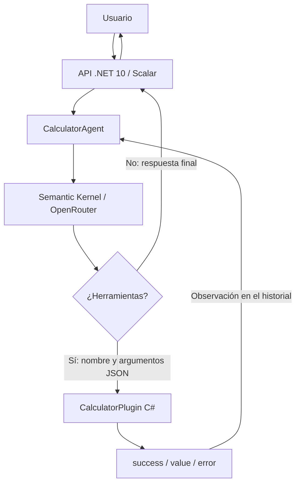
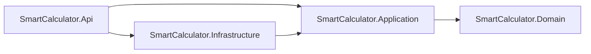

# Agente calculadora inteligente

API en **C# / .NET 10**, **Semantic Kernel** y **Scalar**, conectada a **OpenRouter**. El modelo interpreta lenguaje natural y decide qué herramientas invocar. La aplicación ejecuta las operaciones en C# y devuelve sus observaciones al modelo, permitiendo varios cálculos encadenados en una solicitud.

## Ejecutar

Requisitos: SDK de .NET 10 y una clave de OpenRouter. Desde la raíz, en PowerShell:

```powershell
$env:OPENROUTER_API_KEY = 'tu-clave'
dotnet restore -m:1
dotnet run --project src/SmartCalculator.Api --launch-profile http
```

Abre [Scalar](http://localhost:5279/scalar/v1) para probar `POST /api/calculator`. La documentación y el documento [OpenAPI](http://localhost:5279/openapi/v1.json) se exponen en Development. `GET /health` comprueba el proceso sin llamar a OpenRouter. La API puede arrancar sin clave para consultar la documentación; las solicitudes al agente devuelven 503 hasta configurarla.

La variable correcta es **OPENROUTER_API_KEY** (con `Y` final). No guardes claves en archivos del repositorio. También puedes usar `OpenRouter:ApiKey` mediante configuración externa de ASP.NET Core.

En Bash:

```bash
export OPENROUTER_API_KEY='tu-clave'
dotnet run --project src/SmartCalculator.Api --launch-profile http
```

## Probar un cálculo encadenado

```powershell
$body = @{ message = 'Suma 5 y 3, multiplica el resultado por 2 y calcula su raíz cuadrada.' } | ConvertTo-Json
Invoke-RestMethod 'http://localhost:5279/api/calculator' -Method Post -ContentType 'application/json' -Body $body
```

Respuesta ilustrativa (el texto del modelo puede variar):

```json
{
  "answer": "5 + 3 = 8; 8 × 2 = 16; la raíz cuadrada de 16 es 4.",
  "model": "dots-studio/dots-3-note-preview:free",
  "steps": [
    { "order": 1, "tool": "Calculator.Add", "arguments": { "a": 5, "b": 3 }, "result": { "success": true, "value": 8, "error": null } },
    { "order": 2, "tool": "Calculator.Multiply", "arguments": { "a": 8, "b": 2 }, "result": { "success": true, "value": 16, "error": null } },
    { "order": 3, "tool": "Calculator.SquareRoot", "arguments": { "x": 16 }, "result": { "success": true, "value": 4, "error": null } }
  ]
}
```

Otras solicitudes: «¿Cuánto es 2 elevado a 10 menos 24?», «Divide 10 entre 0», «Calcula la raíz de 81 y también 6 por 7», «¿Qué significa elevar al cuadrado?». Para una explicación conceptual, el modelo puede responder sin herramientas y `steps` estará vacío.

## Arquitectura y Function Calling



`CalculatorPlugin` define seis métodos con `[KernelFunction]` y descripciones de parámetros. Semantic Kernel transforma esas firmas en schemas JSON y las anuncia al modelo: `Add(a,b)`, `Subtract(a,b)`, `Multiply(a,b)`, `Divide(a,b)`, `Power(a,b)` y `SquareRoot(x)`.

El adaptador `SemanticKernelSessionFactory` utiliza `FunctionChoiceBehavior.Auto(autoInvoke: false)`: **el modelo elige las herramientas**, mientras el agente controla su ejecución, el historial y los límites. Primero procesa las herramientas aunque el mismo mensaje también incluya texto. Las operaciones dependientes requieren otro turno del modelo, que recibe el resultado anterior; las independientes pueden llegar juntas. Cada solicitud tiene su propio kernel e historial, sin memoria entre solicitudes.

Los resultados se serializan explícitamente como JSON. Los errores matemáticos también se devuelven al modelo como observaciones para que los explique o corrija. Los pasos de la respuesta son la traza de ejecución; la respuesta textual sigue siendo generada por el modelo y debe interpretarse junto con esa traza.

La integración usa el cliente compatible con OpenAI apuntando a `https://openrouter.ai/api/v1`. Envía `reasoning.enabled` según la configuración; no expone el razonamiento interno en la respuesta. El soporte de herramientas y reasoning depende del modelo/proveedor.

## Configuración

`src/SmartCalculator.Api/appsettings.json` contiene:

| Opción | Predeterminado | Uso |
|---|---|---|
| `Agent:Model` | `dots-studio/dots-3-note-preview:free` | Modelo de OpenRouter |
| `Agent:MaxRounds` | 12 | Peticiones al modelo, incluida la respuesta final |
| `Agent:MaxToolCalls` | 24 | Máximo de herramientas por solicitud |
| `Agent:TimeoutSeconds` | 90 | Plazo total de la solicitud |
| `Agent:ReasoningEnabled` | true | Envía `reasoning.enabled` a OpenRouter |

Puedes sobrescribir opciones con variables, por ejemplo `$env:Agent__Model = 'otro-modelo-con-tools'`. Se reemplazó el modelo inicial `apodex/apodex-1.1-mini:free` porque OpenRouter respondía 404 «No endpoints found». La disponibilidad, cuota gratuita y capacidades de los modelos pueden cambiar. El cliente no realiza reintentos automáticos; el plazo cubre todos los turnos. Reinicia el servidor después de cambiar la clave o el modelo: las variables se heredan al iniciar el proceso.

La entrada admite hasta 4000 caracteres. Las herramientas usan `double`: hay redondeo de coma flotante. Rechazan NaN, infinito, desbordamientos, división por cero y resultados fuera del dominio real. Una herramienta fallida produce `success: false`, `value: null` y un mensaje en `error`.

| HTTP | Significado |
|---|---|
| 200 | Respuesta final, con traza (puede incluir errores matemáticos explicados) |
| 400 | Entrada inválida |
| 422 | Se agotó el presupuesto de turnos o herramientas |
| 502 | Fallo del proveedor o respuesta del modelo inválida |
| 503 | Falta la clave de OpenRouter |
| 504 | Se agotó el tiempo total |

Los errores 502 incluyen `errorCode`, `providerStatus` y `model`. Un `providerStatus` de 404 indica que no hay endpoints para el modelo; 401/403 identifica autenticación o permisos; 402, créditos; 429, límites de solicitudes. Si no se recibió respuesta HTTP, `provider_connection` indica un problema de conexión/DNS. Los registros incluyen estos datos y el `traceId`, sin claves ni cuerpos privados del proveedor.

Esta API es una muestra local, sin autenticación. Antes de publicarla, añade autenticación y límites de uso para proteger la cuota de OpenRouter.

## Clean Architecture



- `src/SmartCalculator.Domain`: operaciones matemáticas y resultados, sin dependencias externas.
- `src/SmartCalculator.Application`: casos de uso, instrucciones, presupuestos, trazas y puertos `IAgentSessionFactory`, `IAgentSession`, `IProviderAvailability` e `IProviderFailureClassifier`. No depende de Semantic Kernel, HTTP ni de la API.
- `src/SmartCalculator.Infrastructure`: sesiones Semantic Kernel, plugins con atributos, cliente OpenRouter, reasoning y clasificación de errores del proveedor; el plugin delega las operaciones en Domain.
- `src/SmartCalculator.Api`: composición, configuración del host, endpoints, validación HTTP, Problem Details y Scalar. `Program.cs` registra los adaptadores mediante `AddInfrastructure()`.
- `tests/SmartCalculator.Application.Tests`: pruebas de casos de uso con sesiones simuladas, cancelación, aislamiento, límites, liberación de recursos y reglas de dependencias; referencia únicamente Application.
- `tests/SmartCalculator.Tests`: pruebas de dominio, adaptadores y contratos HTTP existentes.

Cada solicitud crea una sesión independiente a través del puerto. Application decide cuándo llamar al modelo o ejecutar una herramienta; Infrastructure traduce esas decisiones a Semantic Kernel y conserva su historial nativo. Los contratos JSON, rutas, puertos y opciones de configuración se mantienen.

## Verificación

```powershell
dotnet test SmartCalculator.slnx -m:1
```

Las pruebas no requieren clave ni acceso al modelo: cubren operaciones y errores, cálculos dependientes, varias herramientas por turno, respuestas sin herramientas, cancelación, presupuestos, JSON del conector real y endpoints HTTP/OpenAPI/Scalar. La prueba del conector simula las respuestas HTTP del proveedor y verifica la ruta, las herramientas, `reasoning` y las observaciones encadenadas. Una prueba real con OpenRouter requiere tu clave y disponibilidad del modelo.

## Referencias

- [Semantic Kernel: invocación de funciones](https://learn.microsoft.com/en-us/semantic-kernel/concepts/ai-services/chat-completion/function-calling/function-invocation)
- [Scalar para ASP.NET Core](https://scalar.com/docs-for/dotnet)
- [OpenRouter: catálogo de modelos](https://openrouter.ai/models)
